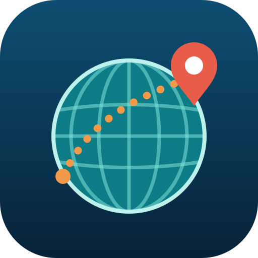
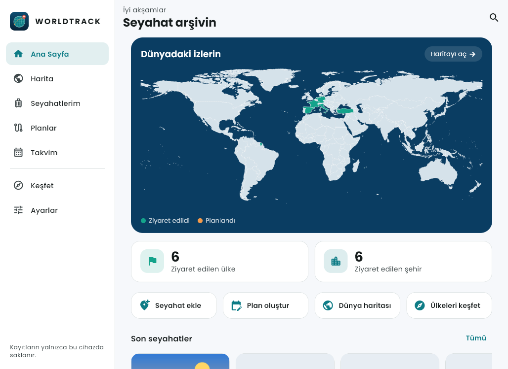
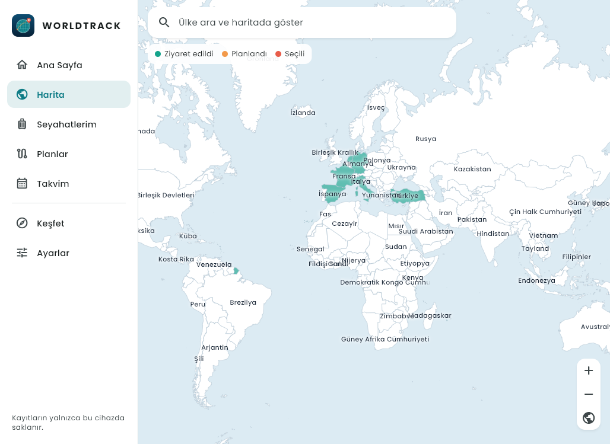
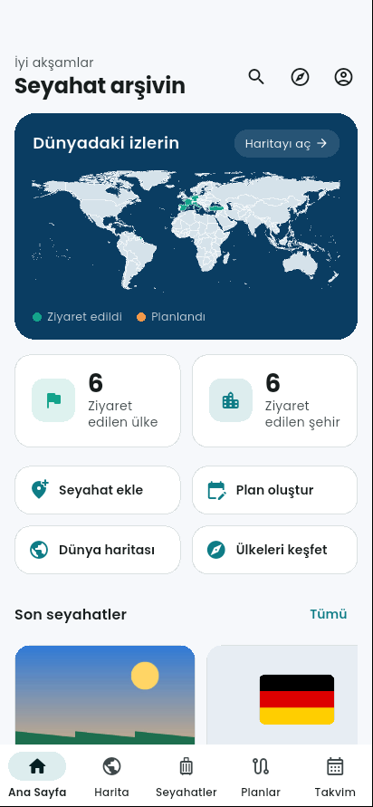
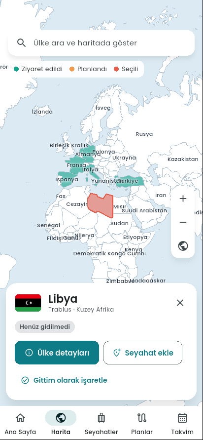
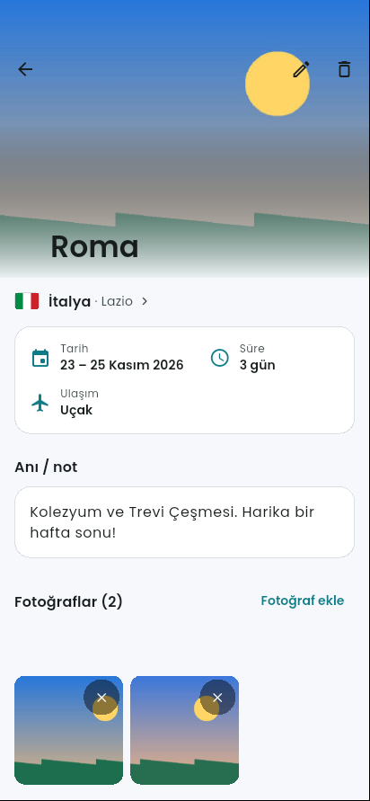
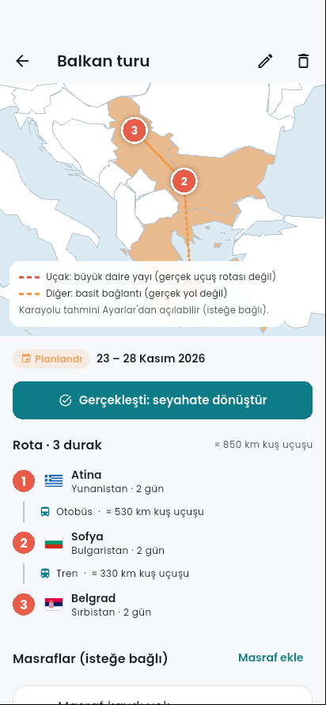

<p align="center">
  
</p>

<h1 align="center">WORLDTRACK</h1>
<p align="center"><b>Senin Dünyan. Senin Yolculuğun.</b><br>
Windows ve Android için kişisel seyahat arşivi ve keşif uygulaması</p>

<p align="center">
  <a href="https://github.com/furkantr1923/worldtrack/actions/workflows/build.yml"></a>
  
  
  
  
</p>

---

WORLDTRACK; gittiğin ülkeleri ve şehirleri etkileşimli bir dünya haritasında işaretlediğin,
seyahatlerini tarih, süre ve fotoğraflarla arşivlediğin, gelecekteki yolculuklarını durak
durak planladığın **tamamen yerel** bir uygulamadır. Hesap açmak gerekmez, veriler buluta
gönderilmez; tüm kayıtların cihazında kalır.

<p align="center">
  
  
</p>
<p align="center">
  
  
  
  
</p>

## Özellikler

| | |
|---|---|
| 🗺️ **Etkileşimli dünya haritası** | Yakınlaştır/kaydır, ülkeye dokun, Türkçe ülke adları. Ziyaret edilen, planlanan ve seçili ülkeler farklı renklerde. Ülke sınırları uygulamanın içinde: **internetsiz de çalışır**. |
| ✈️ **Seyahat kayıtları** | Ülke → şehir → tarih → süre. Ulaşım (uçak, araba, otobüs, tren), kısa not ve fotoğraflar isteğe bağlı. Aynı yere tekrar gidişler desteklenir; yanlışlıkla çift kayıtta uyarır. |
| 📸 **Fotoğraf arşivi** | Çoklu seçim, otomatik önizleme (ayrı iş parçacığında), tam ekran görüntüleyici, yakınlaştırma. Fotoğraflar cihazda tek kopya olarak saklanır. |
| 📊 **Sade istatistik** | Yalnızca iki sayı: ziyaret edilen **ülke** ve **şehir**. Tekrar ziyaretler bir kez sayılır. |
| 🧭 **Plan ve rota** | Durak ekle, sürükle-bırak sırala, ulaşım seç, rotayı haritada gör. Uçuşlar büyük daire yayı, diğerleri "basit bağlantı" olarak dürüstçe etiketlenir. İsteğe bağlı karayolu tahmini (OSRM). |
| ✅ **Plan → seyahat** | Gerçekleşen planı tek dokunuşla seyahat kayıtlarına dönüştür; tarihleri onaylaman yeter. |
| 📅 **Takvim** | Aylık görünüm; gerçekleşen seyahatler ve planlar farklı renklerde. |
| 🌍 **Keşfet ve ülke detayı** | Bayrak, başkent, bölge, nüfus, yüzölçümü, para birimi, Vikipedi özeti, ziyaret ettiğin şehirler ve planların. |
| 🔎 **Türkçe dostu arama** | `munih` → Münih, `cekya` → Çekya, `İSTANBUL` = `istanbul`. ≈250 ülke, ≈32 bin şehir. |
| 💶 **Masraflar (isteğe bağlı)** | Tutar, para birimi, kategori. Farklı para birimleri kur çevrimi yapılmadan ayrı toplanır. |
| 🌗 **Tasarım** | Açık/koyu tema, Windows'ta yan menü ve geniş düzen, Android'de dokunmatik alt gezinme ve doğru geri tuşu davranışı. |

## İndir

Son derlemeler [Releases](https://github.com/furkantr1923/worldtrack/releases) sayfasında ve
CI tarafından güncellenen [`builds`](https://github.com/furkantr1923/worldtrack/tree/builds) dalındadır.

| Platform | Dosya |
|---|---|
| Windows (kurulum) | `WORLDTRACK-1.0.0-Windows-Setup.exe` |
| Windows (taşınabilir) | `WORLDTRACK-1.0.0-Windows-Portable.zip` → `WORLDTRACK.exe` |
| Android 7.0+ | `WORLDTRACK-1.0.0-Android.apk` |

Kurulum adımları: [docs/BUILD_AND_INSTALL.md](docs/BUILD_AND_INSTALL.md)

## API anahtarı gerekiyor mu?

**Hayır.** Hiçbir özellik hesap, ücretli servis veya API anahtarı gerektirmez. Dünya haritası
uygulamanın içinden çizilir (internetsiz çalışır); istenirse ayarlardan anahtarsız OpenStreetMap
altlığı veya kendi karo adresiniz açılabilir. Ayrıntılar ve servis sınırları: [docs/MAP_AND_DATA_SOURCES.md](docs/MAP_AND_DATA_SOURCES.md)

## Gizlilik

* Seyahatler, fotoğraflar ve planlar **yalnızca cihazdaki SQLite veritabanında** tutulur.
* Hesap, bulut eşitleme, analitik veya takip **yoktur**; konum izni istenmez, GPS takibi yapılmaz.
* İnternete giden istekler: harita karoları (görüntülenen bölge), ülke özeti için
  Wikidata/Vikipedi (yalnızca ülke kimliği) ve kullanıcı açarsa güzergâh tahmini (iki durağın koordinatı).
* Çevrimdışıyken kayıtlar ve fotoğraflar tam olarak kullanılabilir; çevrimiçi içerik
  bağlantı gelince otomatik yenilenir.

## Teknik özet

* **Flutter 3.29 / Dart 3.7**, tek kod tabanı, MVVM (Provider + ChangeNotifier)
* **SQLite** (sqflite_common_ffi + sqlite3_flutter_libs), sürümlü şema, yabancı anahtarlar
* **flutter_map** + gömülü Natural Earth poligonları, kendi nokta-poligon seçim testimiz
* Ağır işler (`Isolate.run`): coğrafi veri ayrıştırma, fotoğraf önizleme üretimi
* CI: analiz, birim/widget testleri, **Windows'ta kurulum/açılış/kaldırma testi**,
  **Android emülatöründe kurulum/açılış testi** ve her iki platformda **uçtan uca test**

Belgeler:
[Mimari](docs/ARCHITECTURE.md) ·
[Veritabanı](docs/DATABASE.md) ·
[Harita ve veri kaynakları](docs/MAP_AND_DATA_SOURCES.md) ·
[Derleme ve kurulum](docs/BUILD_AND_INSTALL.md) ·
[Test sonuçları](docs/TEST_RESULTS.md) ·
[Bilinen sınırlamalar](docs/KNOWN_LIMITATIONS.md)

## Proje yapısı

```
lib/
  core/          tema, Türkçe metin, tarih ve coğrafya yardımcıları
  data/          modeller, SQLite şeması/geçişler, depolar (repository)
  services/      harita şekilleri, fotoğraf, bağlantı, Vikipedi, güzergâh, ayarlar
  viewmodels/    ekran modelleri
  ui/            kabuk (gezinme), ekranlar, harita bileşenleri, ortak bileşenler
assets/          ülke/şehir verisi, bayraklar, yazı tipi, logo
test/            birim ve widget testleri
integration_test/ uçtan uca test (Windows + Android)
installer/       Inno Setup kurulum betiği
tool/            veri hazırlama, ikon üretimi, CI betikleri
```

## Veri kaynakları ve lisanslar

Ülke sınırları © [Natural Earth](https://www.naturalearthdata.com) (kamu malı) ·
Ülke ve şehir verisi © [GeoNames](https://www.geonames.org) (CC BY 4.0) ·
Bayraklar: [country-flags](https://github.com/hampusborgos/country-flags) (kamu malı) ·
Ülke özetleri: Türkçe Vikipedi (CC BY-SA 4.0) ·
İsteğe bağlı altlık © OpenStreetMap katkıda bulunanlar ·
Yazı tipi: Poppins (SIL OFL 1.1)

Uygulama kodu [MIT Lisansı](LICENSE) ile yayımlanmıştır.

---

<p align="center">Developed by <b>Furkan Baykal</b> · <a href="https://github.com/furkantr1923">github.com/furkantr1923</a></p>
